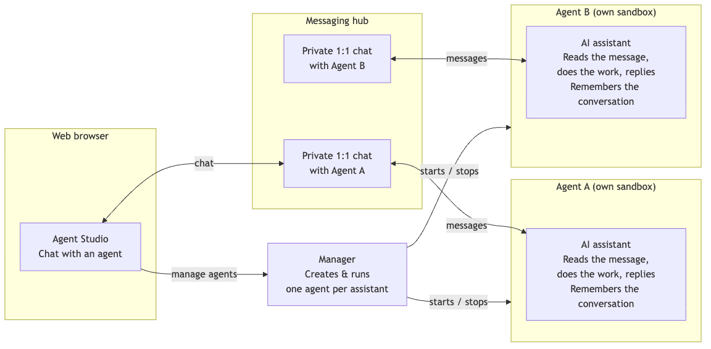

# Agent Studio

> A self-hosted platform for AI agents that **remember**, **act on their own**, and **work together as a team** — running entirely inside your own infrastructure, on the model provider you control.

For a guided, visual tour of every concept below, open **[`docs/platform-story.html`](./docs/platform-story.html)** in your browser.

---

## At a glance



A person chats with an agent in the **Agent Studio** browser UI. Each conversation runs in a **private 1:1 chat** carried by a self-hosted messaging hub. A **manager** creates and runs one **agent** per assistant — each in its own sandbox, where it reads the message, does the work, replies, and remembers the conversation.

---

## Why it exists

Most enterprise AI assistants share the same three limits: they forget everything between sessions, they only act when a human prompts them, and they live on someone else's servers.

Agent Studio is built to remove all three. It gives you **persistent AI agents** that keep a living memory of your domain, **run autonomously** on schedules and real-world events, and **collaborate in orchestrated teams** — all on Podman inside your network, pointed at whichever Anthropic-compatible model gateway your organization uses.

Under the hood each agent is a full **Claude Code** instance with its own workspace, so it can read code, edit files, run commands, commit, and open pull requests — not just chat.

---

## The mental model

Five ideas are enough to understand the whole platform.

### 1. An agent is a persistent worker

Each agent is its own Matrix chat user with its own isolated container and workspace. You talk to it in a private 1:1 chat. Between messages it keeps a **memory** — a set of files it reads and writes as it works — so it recalls past decisions and accumulated domain knowledge without you repeating yourself. An agent can be a simple chat specialist or an autonomous worker that acts without being asked.

### 2. Skills teach an agent what it knows

**Skills** are portable folders of domain knowledge and procedure. Drop one into an agent's toolkit and it gains an expertise — COBOL analysis, a review checklist, a migration pattern — with no code change. Skills live in a shared pool (global or per-team) and can be promoted, reused, and versioned. Training a new specialist is a matter of picking the right skills.

### 3. A Working Environment is a reusable workspace recipe

A **Working Environment** bundles *what an agent starts with*: which skills to seed, which git repository to clone, which MCP knowledge sources to connect, and any extra context to inject into its prompt. Point several agents at the same environment and they all begin from the same footing. Credentials (SSH keys, GitHub tokens, MCP secrets) are stored separately and referenced by the environment — so secrets rotate independently and never leak into a config.

### 4. Triggers make agents autonomous

Agents don't have to wait to be summoned. A **trigger** wires an agent to fire on its own:

- **cron** — recurring (a daily status report every morning)
- **once** — a single future moment
- **http webhook** — an external system POSTs to wake it
- **github-event** — a pull request opens, an issue gets labeled, code is pushed

When a trigger fires, the orchestrator wakes the agent, hands it context (including the full event payload), and records the result. Triggers fire on any matching event regardless of who caused it (no source/origin filtering); a per-conversation rate throttle and burst digests keep a busy repository from launching a flood of sessions.

### 5. Flows connect agents into a process

A single agent is useful; a coordinated **team** solves real enterprise problems. In the **Flows** view you design a multi-agent process on a canvas — a business analyst, a developer, reviewers, a doc writer — and wire them together with first-class connections:

- **Label hand-offs** — one agent emits a label, another listens for it
- **GitHub PR / Issue channels** — an agent opens a PR or issue; downstream agents react to it
- **Data-flow hand-offs** — a producer registers an artifact by name; a consumer is woken to pick it up
- **Hierarchy** — parent/child grouping of members
- **Human approval gates** — an edge that waits for a person to apply an approving label before work flows on

You can start from a curated **process template**, compose one stage-by-stage, or draw on a blank canvas. Export a finished process as a portable, git-committable JSON bundle and materialize it into a live team with one action. The **Team-Setup wizard** is the guided front door to the same machinery: pick a process, pick an environment, name the team, done.

---

## What sets it apart

**Agents that remember and learn.** Living memory plus portable skills means an agent accumulates expertise instead of starting cold every session.

**Autonomous operation, triggered by anything.** Cron, webhooks, and GitHub events let agents work while no one is watching — with built-in loop protection so automation stays safe.

**Orchestrated teams, designed visually.** The Flows canvas turns "a squad of specialists coordinating over GitHub" from an architecture project into a diagram you draw, template, and share.

**Fully self-hosted, provider-agnostic.** The entire stack runs on Podman in your network. Point it at the public Anthropic API, a LiteLLM proxy, Azure AI Foundry, or an internal enterprise gateway. Model providers support both API-key and Claude subscription (OAuth) authentication.

**Multi-user and governed.** Human **Teams** scope who sees and manages what. Every configuration change is written to an append-only audit trail, and the whole Admin Console sits behind a login.

---

## How it works

Agent Studio runs as a single Podman compose stack with four services:

| Service | Role |
|---|---|
| **Conduwuit** (Matrix homeserver) | The communication backbone. Humans and agents meet in private 1:1 chat rooms hosted entirely on your network — no external messaging service. |
| **Orchestrator** | The engine. Manages agent lifecycles, spawns **one isolated container per agent**, runs the trigger scheduler, polls GitHub, routes process events, and serves the internal API. It has no chat identity of its own. |
| **Admin Console** | The control plane on `:4000`. A browser UI for creating agents, managing credentials and environments, designing Flows, watching live sessions, and chatting with any agent directly. |
| **bp-explorer** | A read-only viewer for Briefing-Pack metadata (used by the orchestrator agent role). |

Each agent runs in its **own container** with an isolated network and filesystem, carries a label so the orchestrator can reconcile live state, and drives the Claude Code CLI. Everything an agent does — messages, tool calls, results, trigger runs — is streamed to an append-only session log you can watch live in the console.

```
Admin Console chat UI  (or any Matrix client, e.g. Element)
        │
   Conduwuit  (localhost:8448)
        │
        └── 1:1 DM rooms, one per agent
               ├── @business-analyst:local   ← container: as-agent:latest
               ├── @developer:local          ← container: as-agent:latest
               └── @code-reviewer:local      ← container: as-agent:latest (autonomous)

   Orchestrator  (control-plane container, no chat identity)
        ├── Agent lifecycle: create / enable / disable / delete
        ├── One Podman container per agent (network + filesystem isolation)
        ├── Trigger scheduler + GitHub poller + process-event routing
        └── Internal API consumed by the Admin Console
```

---

## Quick Start

**Prerequisites:** Podman with `podman compose`, and an LLM endpoint that speaks the Anthropic Messages API (the Anthropic API directly, a LiteLLM proxy, Azure AI Foundry, or any internal gateway).

```bash
# 1. Copy the environment config and fill in your provider URL + auth token.
cp .env.example .env
#    On Windows or Linux, also set PODMAN_HOST_SOCKET in .env — the default
#    in docker-compose.yml is the macOS path. Discover yours with:
#      podman machine inspect --format '{{.ConnectionInfo.PodmanSocket.Path}}'

# 2. Boot the Matrix homeserver and register the admin account.
#    The script prints an access token — paste it into .env.
podman compose up -d conduwuit
./orchestrator/setup.sh

# 3. Seed the shared pool (one-time): skills, baseline memory, role templates,
#    process templates, MCP reference servers. `make up` does NOT seed for you.
make seed-pool

# 4. Start the full stack (builds the per-agent image automatically).
make up

# 5. Tail logs.
make logs
```

Then:

6. Open **http://localhost:4000** and log in (default `admin` / `admin` — change it in `.env`).
7. The **Setup Wizard** walks you through connecting a Model Provider, adding an SSH key and GitHub token, defining a Working Environment, and creating your first agent — or jump straight to **Team Setup** to stand up a whole process.
8. Open the agent in **Agent Chat**, send it a message, and watch the session log stream on the right.

You now have a live, persistent AI agent running inside your own infrastructure.

### Windows setup notes

The steps above work on Windows with these additions:

1. **Install `jq`** (required by `setup.sh`): `winget install --id jqlang.jq`. Restart your shell so it's on `PATH`.
2. **Pre-set credentials in `.env`** — `setup.sh` uses an interactive password prompt that is unreliable in Git Bash. Add `ADMIN_USER=admin` and `ADMIN_PASS=yourpassword` before running it.
3. **Run the script via bash explicitly:** `bash orchestrator/setup.sh`.
4. **Create `~/.gitconfig` before `make up`** — `bp-explorer` bind-mounts it and fails to start if it's missing:
   ```bash
   git config --global user.name "Your Name"
   git config --global user.email "you@example.com"
   ```

---

## Documentation

Start with the visual walkthrough, then dive into the reference docs as needed.

| Topic | Document |
|---|---|
| Visual platform walkthrough | [docs/platform-story.html](./docs/platform-story.html) |
| Agent roles & team patterns | [docs/agent-roles.md](./docs/agent-roles.md) |
| Working Environments | [docs/working-environments.md](./docs/working-environments.md) |
| Triggers (cron, once, webhook, GitHub event) | [docs/triggers.md](./docs/triggers.md) |
| Flow / process connection model | [docs/flow-connection-model.md](./docs/flow-connection-model.md) |
| Process-template bundle format | [docs/process-template-format.md](./docs/process-template-format.md) |
| Team-Setup wizard & Flow integration | [docs/wizard-flow-integration.md](./docs/wizard-flow-integration.md) |
| Skills system | [docs/skills-system.md](./docs/skills-system.md) |
| Persistent memory | [docs/persistent-memory.md](./docs/persistent-memory.md) |
| SSH keys & GitHub tokens | [docs/credentials.md](./docs/credentials.md) |
| Model Providers | [docs/model-providers.md](./docs/model-providers.md) |
| MCP servers | [docs/mcp-servers.md](./docs/mcp-servers.md) |
| Admin Console reference | [docs/admin-console.md](./docs/admin-console.md) |
| Teams & multi-user model | [docs/teams-data-model.md](./docs/teams-data-model.md) · [docs/multi-user-concept.md](./docs/multi-user-concept.md) |
| GCP hosting (pilot VM): access, deploy, operations | [docs/hosting/gcp/vm-podman-runbook.md](./docs/hosting/gcp/vm-podman-runbook.md) |
| Key files & project layout | [docs/key-files.md](./docs/key-files.md) |

## Third-party Models

Speech-to-text powered by [NVIDIA Parakeet TDT 0.6B v3](https://huggingface.co/nvidia/parakeet-tdt-0.6b-v3).

- **Model license:** [CC-BY-4.0](https://creativecommons.org/licenses/by/4.0/) — Copyright NVIDIA Corporation
- **ONNX conversion:** [istupakov/parakeet-tdt-0.6b-v3-onnx](https://huggingface.co/istupakov/parakeet-tdt-0.6b-v3-onnx) — [CC-BY-4.0](https://creativecommons.org/licenses/by/4.0/)
- **Inference library:** [onnx-asr](https://github.com/istupakov/onnx-asr) — [MIT](https://opensource.org/licenses/MIT)
- No retraining or fine-tuning performed.

## Contributing

Bug reports and pull requests are welcome. Please open an issue first to discuss significant changes before submitting a PR.
