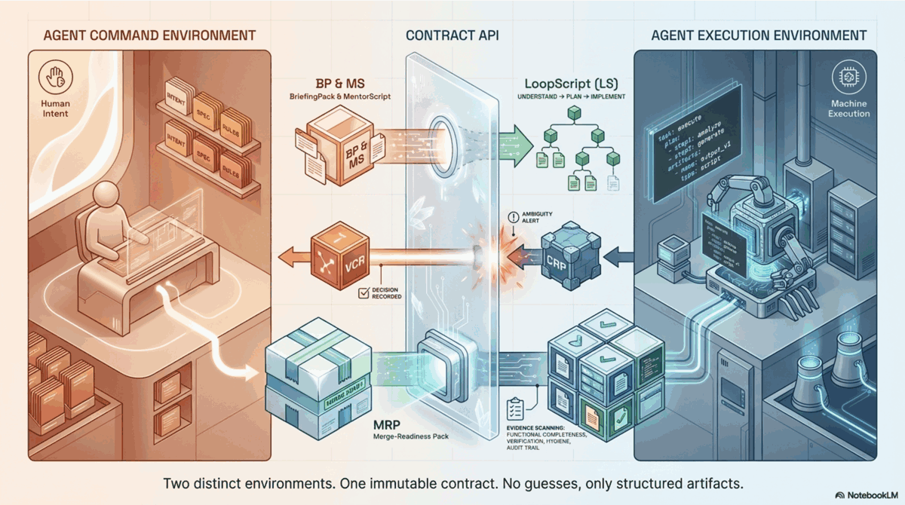
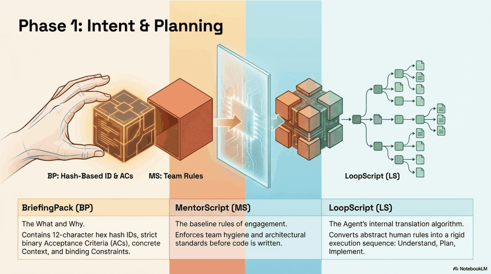
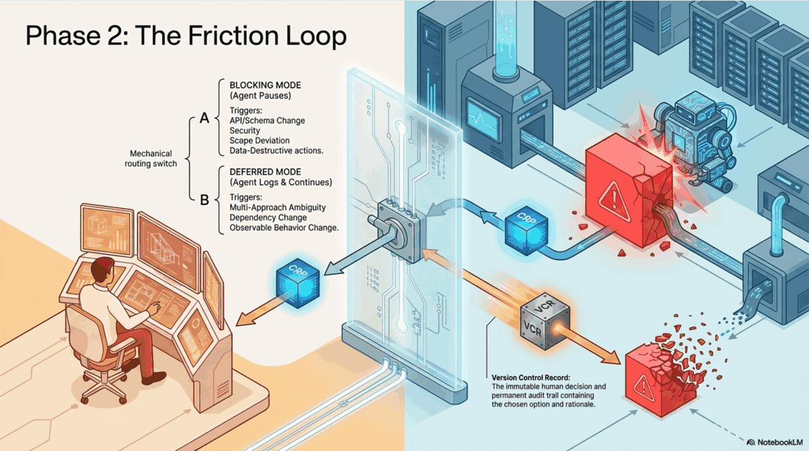
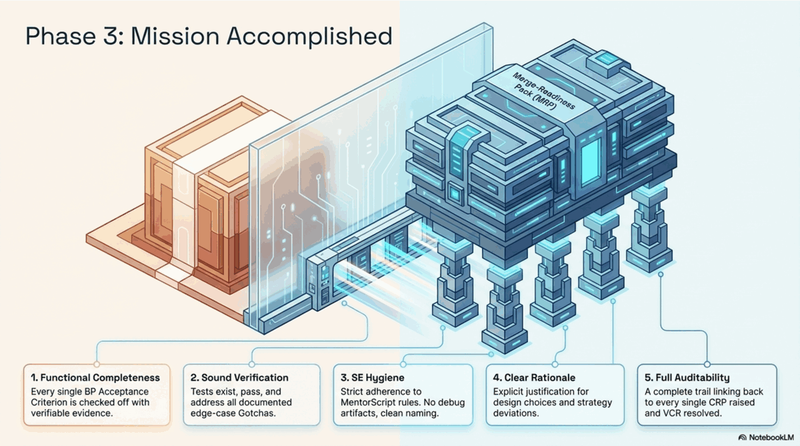
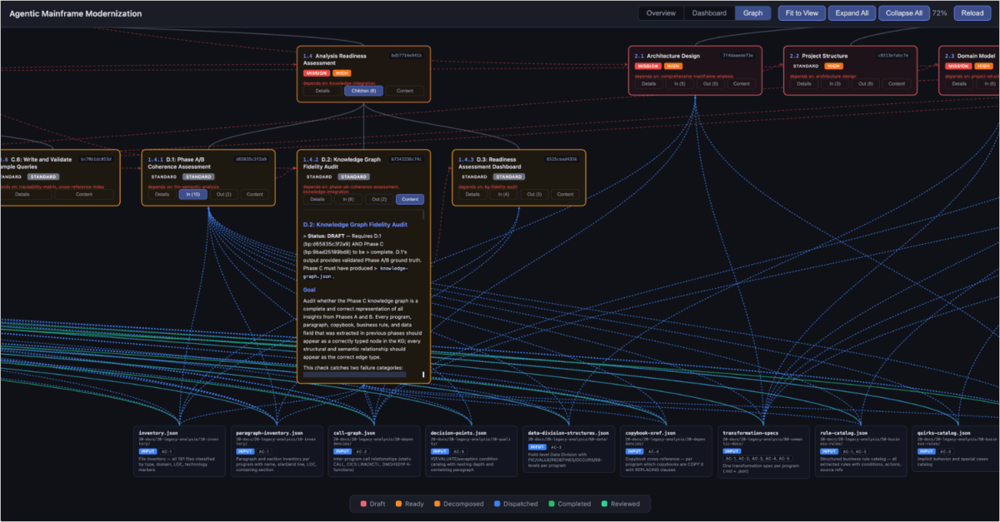
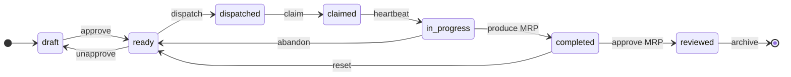
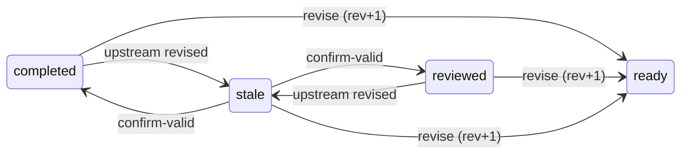

# ACE -- Agent Control Environment

> Structured collaboration between humans and AI agents, built on Git and Markdown.

ACE is a Claude Code plugin that replaces ad-hoc AI prompting with a disciplined, auditable process. You describe what you want. Agents plan, execute, and prove their work -- asking when uncertain instead of guessing. The amount of ceremony scales with the stakes: a bug fix gets none, a database migration gets the full process.

Based on the [SASE framework](https://arxiv.org/abs/2509.06216) (Hassan et al., 2025).

---

## The Problem

AI coding agents are fast. But speed without structure means:

- **Agents guess instead of asking** -- wrong assumptions, wasted review cycles
- **No clear handoff** -- "just fix the PR" loops between human and agent
- **No audit trail** -- who decided what, when, and why?
- **One-size-fits-all** -- same process for a typo fix and a COBOL migration

## The Solution

ACE bridges the gap between speed and trust. Two separate environments -- one for humans, one for agents -- connected by structured artifacts that both can read and act on.



*Two environments. One immutable contract. No guesses, only structured artifacts.*

---

## How It Works: 3 Phases

Every task in ACE follows the same arc: **plan, execute with guardrails, prove it's done.**

### Phase 1: Intent & Planning



You describe what you want in an **Agent definition** -- goal, acceptance criteria, context, constraints. The agent's rules (**MentorScript**) apply automatically. The agent converts your intent into a structured execution plan (**LoopScript**).

- **Agent** -- the "what" and "why": strict acceptance criteria, concrete context, binding constraints
- **MentorScript** -- the baseline rules: team hygiene and architectural standards before any code is written
- **LoopScript** -- the agent's internal plan: understand, plan, implement

### Phase 2: Execution with Guardrails



The agent works through the plan. When it hits a security decision, an API change, or scope deviation, it doesn't guess -- it files a **Consultation Request Protocol (CRP)**.

**Blocking** triggers (agent pauses): API/schema changes, security, scope deviation, data-destructive operations.
**Deferred** triggers (agent logs and continues): multi-approach ambiguity, dependency changes, observable behavior changes.

Your decision is recorded in an immutable **Version Control Record (VCR)** -- the permanent audit trail of every human choice.

### Phase 3: Evidence-Based Review



The agent proves its work is done with a **Merge-Readiness Pack (MRP)** -- evidence against 5 criteria:

1. **Functional Completeness** -- every acceptance criterion checked off with verifiable evidence
2. **Sound Verification** -- tests exist, pass, and address documented edge cases
3. **SE Hygiene** -- adherence to MentorScript rules, clean naming, no debug artifacts
4. **Clear Rationale** -- explicit justification for design choices and strategy deviations
5. **Full Auditability** -- complete trail linking back to every CRP raised and VCR resolved

You review evidence, not raw code.

---

## Quick Start

```bash
# Install the plugin
claude plugin install ace

# Initialize your project
/ace:init

# Try a quick task
/ace:do Fix the broken test in auth.spec.ts

# Or start the interactive onboarding
/ace:getting-started
```

`/ace:init` scaffolds the directory structure, copies rules and scripts, and generates a project-level `CLAUDE.md`. From there, pick the right tier for each task:

### The 3 Tiers

| Tier | Command | When to Use | What Happens |
|------|---------|-------------|--------------|
| **Quick** | `/ace:do` | Bug fixes, small refactors, test additions | Agent confirms a short plan, executes, reports back. No artifacts created. |
| **Standard** | `/ace:brief` | Features, module changes, integrations | Agent drafts a mission plan, you review and approve, agent executes with structured oversight. |
| **Mission** | `/ace:brief --full` | Migrations, security overhauls, multi-team work | Interactive briefing, hierarchical decomposition, multi-agent coordination, explicit launch. |

The system assesses scope automatically and picks the right tier. Override with `--force`.

---

## Agent Dashboard

The **Agent Dashboard** is a visual dashboard for browsing Agents, tracking agent status, and managing escalations/reviews in your browser.



### Start with Docker (recommended)

```bash
bash scripts/bp-explorer/start.sh
# Open http://localhost:8765
```

Or run manually:

```bash
docker compose -f scripts/bp-explorer/docker-compose.yml up
```

### Start without Docker

```bash
pip install -r scripts/bp-explorer/requirements.txt
python3 scripts/bp-explorer/server.py
# Open http://localhost:8765
```

---

## Commands

| Command | Purpose |
|---------|---------|
| `/ace:init` | Initialize ACE in your project |
| `/ace:do` | Quick task -- describe, confirm, execute |
| `/ace:brief` | Define an Agent for standard or mission work |
| `/ace:status` | Dashboard of open escalations, pending reviews, active Agents, stale agents |
| `/ace:dispatch` | Manually launch child Agents (Tier 3) |
| `/ace:review-mrp` | Review an agent's evidence package against 5 merge-readiness criteria |
| `/ace:resolve-crp` | Answer an agent's structured question with a recorded decision |
| `/ace:compare` | Compare multiple agent implementations (N-Version programming) |
| `/ace:getting-started` | Interactive 5-minute onboarding walkthrough |

## Team Roles

ACE is built for teams. Identity comes from `git config user.name` -- no separate user management.

| Role | Responsibility |
|------|---------------|
| **Author** | Create and edit Agent definitions |
| **Contributor** | Refine Agents with domain context and constraints |
| **Approver** | Mark Agents as ready for execution |
| **Dispatcher** | Launch ready Agents |
| **Reviewer** | Evaluate MRPs and approve/reject agent work |

## Agent Lifecycle

Each Agent moves through a defined lifecycle. Status transitions are authorized by role and recorded in Git history -- no separate state store, no surprises.

### Leaf Agents

Leaf Agents are the units of actual work. They flow through a forward path with explicit recovery branches:



| State | Meaning | Transition By |
|-------|---------|---------------|
| `draft` | Agent is being authored or refined | Author / Contributor |
| `ready` | Approved, awaiting dispatch | Approver |
| `dispatched` | Assigned to an AI teammate, not yet picked up | Dispatcher |
| `claimed` | Lock acquired, work has started | Agent (auto) |
| `in-progress` | Actively executing (heartbeat ≤ 3h) | Agent (auto) |
| `completed` | MRP produced, ready for review | Agent (auto) |
| `reviewed` | MRP approved, work merged to `main` | Reviewer |

### Recovery & Revision

Real work doesn't always go in a straight line. ACE makes course correction explicit and auditable:

| Action | Effect | Authorized |
|--------|--------|------------|
| **Unapprove** | `ready` → `draft` for further refinement | Approver |
| **Reset** | `completed` → `ready`, discards agent work | Author / Approver |
| **Abandon** | Stale lock released (heartbeat > 3h, no blocking CRPs); BP returns to `ready`, agent branch preserved | Human via `/ace:status` |
| **Revise** (`/ace:revise`) | Re-execute a `completed`, `reviewed`, or `stale` Agent. Bumps revision counter, preserves audit trail, **cascade-flags direct dependents as `stale`** | Author / Approver |
| **Confirm Valid** (`/ace:confirm-valid`) | Reviewer asserts a `stale` Agent's prior work is still valid -- prior status restored, cascade stops | Reviewer |
| **Archive** (`/ace:archive`) | Physical move of reviewed BP tree to `artifacts/briefings/.archive/`; restorable | Author / Approver |

The `stale` state is the integrity signal: it appears whenever an upstream Agent has been revised, telling downstream Reviewers "your inputs may have changed -- re-validate or confirm." Cascading stops at the first `confirm-valid` or once revisions propagate through the chain.



### Parent Agents

Parent Agents (those with child BPs) **never store a status** -- it is derived automatically from their children:

| Children | Parent State |
|----------|--------------|
| Any child `stale` | `stale` |
| All children `reviewed` | `reviewed` |
| All `completed` or `reviewed` | `completed` |
| Any `dispatched` / `claimed` / `in-progress` | `in-progress` |
| All children at least `ready` | `ready` |
| Otherwise | `draft` |

Only leaf Agents are dispatched; parents coordinate but never execute.

## Enterprise Features

- **Git-based agent locking** -- branch-per-agent isolation with push-based claim protocol, no external coordination
- **Review policies that scale with risk** -- one reviewer for routine, two for security, all for critical infrastructure
- **Immutable audit trail** -- every human decision recorded in a VCR, traceable back to the code change
- **Stale agent detection** -- heartbeat monitoring flags silent agents, locks auto-released after 3 hours
- **Structured commits** -- every commit references BP and agent ID: `git log --grep='bp:a3f7c2'`

---

## Documentation

| Document | Audience | What It Covers |
|----------|----------|---------------|
| **This README** | Everyone | Concept, quick start, commands |
| [Operations & Configuration](docs/README-EXTENDED.md) | Setup & ops | Directory structure, team setup, Git integration, troubleshooting |
| [Framework Guide](docs/SASE-FRAMEWORK-GUIDE.md) | Deep dive | Every SASE concept from the academic paper, mapped to this implementation |
| [Roadmap](docs/ROADMAP.md) | Contributors | Future plans and prioritized ideas |

## License

MIT
